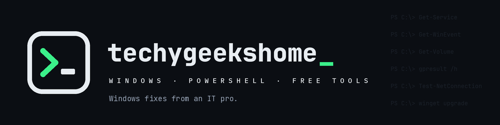

<div align="center">



**Windows fixes from an IT pro.** Free Windows tools and browser extensions that each do one job well, plus 770+ guides at [techygeekshome.info](https://techygeekshome.info).

No ads, nothing bundled, no sign-up, no tracking.

</div>

## Free Windows tools

| App | What it does |
|---|---|
| [AppGeek](https://github.com/techygeekshome/AppGeek) | Update everything on your PC in one run, and install from a curated catalogue. Built on winget. |
| [AuthGeek](https://github.com/techygeekshome/AuthGeek) | Offline two-factor authenticator. Your codes in one encrypted vault on your own machine. |
| [CleanGeek](https://github.com/techygeekshome/CleanGeek) | Recovers real space from caches, temp files and update leftovers. No registry cleaner. |
| [CutGeek](https://github.com/techygeekshome/CutGeek) | Removes photo backgrounds locally, at full resolution, with no watermark. |
| [DiskGeek](https://github.com/techygeekshome/DiskGeek) | Shows what is actually filling a drive, finds duplicates and tracks what grew. |
| [DriverGeek](https://github.com/techygeekshome/DriverGeek) | Every driver on the machine, and the updates Windows Update keeps hidden. |
| [LingoGeek](https://github.com/techygeekshome/LingoGeek) | Offline document translator for Word, PDF, subtitles and text. |
| [PDFGeek](https://github.com/techygeekshome/PDFGeek) | Merge, split, extract, rotate, watermark and password-protect PDFs offline. |
| [ReelGeek](https://github.com/techygeekshome/ReelGeek) | Turns a folder of photos into a vertical reel cut to the beat. |
| [ShortGeek](https://github.com/techygeekshome/ShortGeek) | Turns a script into a narrated, captioned vertical short. |
| [SoundGeek](https://github.com/techygeekshome/SoundGeek) | Removes background noise and hum, and evens out the levels. |
| [TranscribeGeek](https://github.com/techygeekshome/TranscribeGeek) | Turns recordings into text on your own machine. |
| [VideoSizeGeek](https://github.com/techygeekshome/VideoSizeGeek) | Fits a video into an exact size limit for Discord, Gmail or WhatsApp. |
| [MetaRestoreGeek](https://github.com/techygeekshome/MetaRestoreGeek) | Puts dates and locations from a Google Takeout export back into your photos. |
| [Ultimate Settings Panel](https://github.com/techygeekshome/Ultimate-Settings-Panel) | 250+ Windows settings, tools and commands in one searchable panel. |

Browse them all at [techygeekshome.info/geek-tools](https://techygeekshome.info/geek-tools/). Several are in winget:

```powershell
winget search TechyGeeksHome
```

## Browser extensions

Free extensions for Chrome, Edge and other Chromium browsers. Everything runs on your own computer.

### Save and download

| Extension | What it does |
|---|---|
| [Board Saver for Pinterest](https://github.com/techygeekshome/BoardSaver) | Saves every image on a Pinterest board in full quality, duplicates removed, in one ZIP. |
| [Grid Saver for Instagram](https://github.com/techygeekshome/GridSaver) | Saves the photos, reels and carousels from an Instagram profile or post in full quality. |
| [Clip Saver for TikTok](https://github.com/techygeekshome/ClipSaver) | Saves TikTok videos and photo posts from a profile or a single video in the best quality. |
| [Reddit Saver](https://github.com/techygeekshome/RedditSaver) | Saves the pictures, galleries and videos (with sound) from a post, user or subreddit. |
| [Bluesky Saver](https://github.com/techygeekshome/BlueskySaver) | Saves every picture and video from a Bluesky profile, post or feed. Videos come down as MP4. |
| [Page Saver](https://github.com/techygeekshome/PageSaver) | Saves every image on a web page at its biggest size, plus its videos, in one ZIP. |
| [Image Format Saver](https://github.com/techygeekshome/ImageFormatSaver) | Right-click any picture to save it as JPG, PNG or WebP, or copy it as PNG. |
| [Screenshot Saver](https://github.com/techygeekshome/ScreenshotSaver) | Full page, visible part or a picked area. Save as PNG, JPG or PDF, or copy it. |
| [Markdown Saver](https://github.com/techygeekshome/MarkdownSaver) | Saves any web page or selection as clean Markdown for Obsidian and notes. |

### Browser tools

| Extension | What it does |
|---|---|
| [PDFGeek: PDF Tools](https://github.com/techygeekshome/PDFGeekExtension) | Merge, split, crop, rotate and lock PDFs, and turn pictures into PDFs. Nothing is uploaded. |
| [TextGeek](https://github.com/techygeekshome/TextGeek) | Drag a box over any picture, video or screenshot and copy the text in it. |
| [ErrorGeek](https://github.com/techygeekshome/ErrorGeek) | Look up any Windows error code offline: HRESULT, Win32, NTSTATUS and Windows Update. |
| [SpeedGeek](https://github.com/techygeekshome/SpeedGeek) | Speed up or slow down any video or audio, 0.1x to 16x. Remembers your speed per site. |
| [VolumeGeek](https://github.com/techygeekshome/VolumeGeek) | Boost any tab up to 600%, or tune it with a simple bass, mid and treble equaliser. |
| [PiPGeek](https://github.com/techygeekshome/PiPGeek) | Pop the main video on any page out into a floating window with one click or Alt+P. |
| [TabGeek](https://github.com/techygeekshome/TabGeek) | Frees up memory by putting tabs you have not used for a while to sleep. |
| [FocusGeek](https://github.com/techygeekshome/FocusGeek) | Blocks distracting websites all the time, on a schedule or during a focus timer. |
| [RefreshGeek](https://github.com/techygeekshome/RefreshGeek) | Auto refresh any tab on a timer, or watch part of a page and get an alert when it changes. |
| [ColorGeek](https://github.com/techygeekshome/ColorGeek) | Pick any colour on screen and copy it as HEX, RGB or HSL. Checks contrast too. |
| [Country Filter for X](https://github.com/techygeekshome/CountryFilterForX) | Hide or blur X posts and replies from the countries and regions you choose. |

Guides, screenshots and downloads for every extension at [techygeekshome.info/browser-extensions](https://techygeekshome.info/browser-extensions/).

## WordPress

| Project | What it does |
|---|---|
| [NeoDark](https://github.com/techygeekshome/NeoDark) | Fast, dark-mode WordPress theme for tech guides and tutorials. |
| [LinkGather](https://github.com/techygeekshome/LinkGather) | Audit every URL on your site, then filter, sort and export to CSV. |
| [Controlled Draft Publisher](https://github.com/techygeekshome/Controlled-Draft-Publisher) | Publishes drafts automatically on a schedule you control. On [WordPress.org](https://wordpress.org/plugins/controlled-draft-publisher/). |
| [BackBurner Post Archiver](https://github.com/techygeekshome/Backburner-Post-Archiver) | Moves old content out of circulation after a set age. On [WordPress.org](https://wordpress.org/plugins/backburner-post-archiver/). |

## Elsewhere

[Website](https://techygeekshome.info) · [YouTube](https://www.youtube.com/@techygeekshome) · [TikTok](https://www.tiktok.com/@techygeekshome) · [Instagram](https://www.instagram.com/techygeekshome.info) · [Facebook](https://www.facebook.com/techygeekshome.info) · [X](https://x.com/TechyGeeks1) · [All links](https://techygeekshome.github.io/) · [Support on Ko-fi](https://ko-fi.com/techygeekshome)
